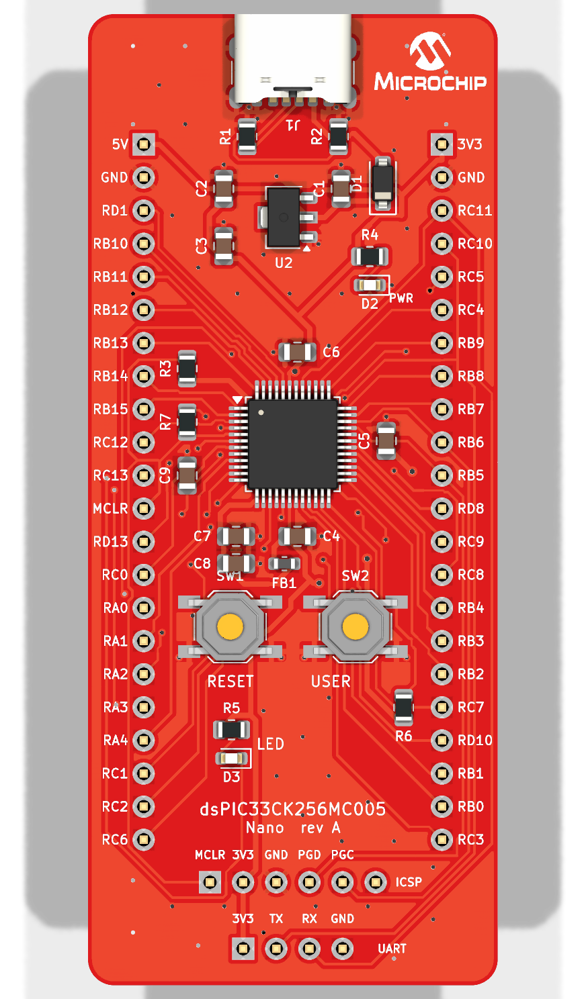
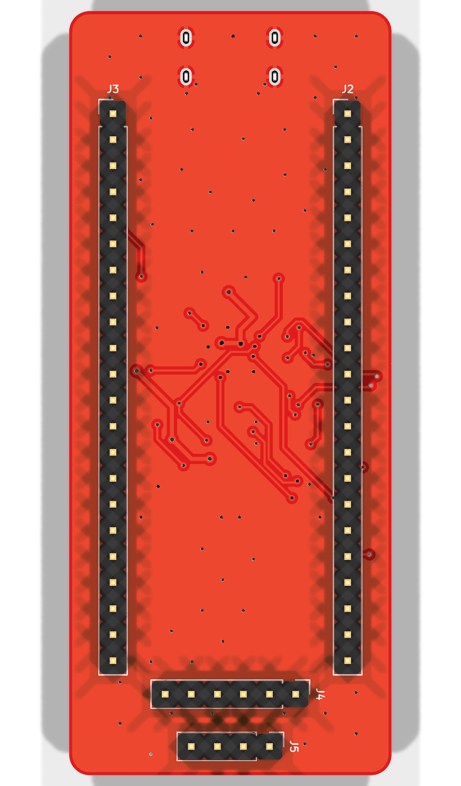
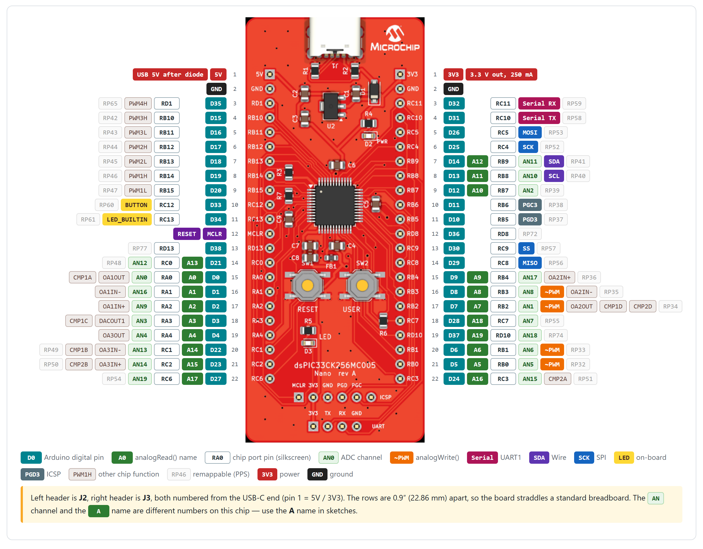

# dsPIC33CK Nano

An open-hardware breadboard board for the Microchip **dsPIC33CK256MC005**
(100 MIPS dsPIC DSC), with an **Arduino-compatible core** and a 30-lab course.

<p align="center">
  
  
</p>

## 📘 Lab manual

| | |
|---|---|
| **Lab manual (English)** | [**Open the lab manual**](https://microchipthailand.github.io/dspic33ck-nano/arduino/dsPIC33CK_Nano_Labs.html): 30 step-by-step labs with wiring diagrams |
| **คู่มือการทดลอง (ภาษาไทย)** | [**เปิดคู่มือภาษาไทย**](https://microchipthailand.github.io/dspic33ck-nano/arduino/dsPIC33CK_Nano_Labs_TH.html) |
| **Pinout page** | [Board pinout and Arduino pin functions](https://microchipthailand.github.io/dspic33ck-nano/arduino/dsPIC33CK_Nano_Pinout.html) |

The labs go from *Basics* (Blink, Serial, ADC, PWM, I2C, SPI) through *Advanced*
(interrupts, timers, DMA, DAC, flash EEPROM, RTOS, watchdog) to *Application*
(data logger, GPS, WS2812B, OLED, Modbus RS485, LIN, CAN, 10BASE-T1S, line-follower
robot, PID temperature control). Every lab has objectives, background theory, a
parts list, a wiring diagram, steps, expected output, a code walk-through,
exercises and troubleshooting.

<sub>If the links above do not open, the pages are also in the repo:
[`arduino/dsPIC33CK_Nano_Labs.html`](arduino/dsPIC33CK_Nano_Labs.html) ·
[`arduino/dsPIC33CK_Nano_Labs_TH.html`](arduino/dsPIC33CK_Nano_Labs_TH.html) ·
[`arduino/dsPIC33CK_Nano_Pinout.html`](arduino/dsPIC33CK_Nano_Pinout.html)
(download, then open in a browser).</sub>

## 📌 Board pinout

<p align="center">
  
</p>

Left header **J2**, right header **J3**, both numbered from the USB-C end. The rows
are 0.9" apart, so the board straddles a standard breadboard. Use the Arduino
names (`D5`, `A2`, ...) in sketches.

| Function | Arduino pin | Chip pin | Header |
|---|---|---|---|
| Power out | 3V3 (250 mA) / 5V (USB) | – | J3-1 / J2-1 |
| GND | – | – | J2-2, J3-2 |
| `LED_BUILTIN` (active low) | D34 | RC13 | J2-11 |
| `BUTTON_BUILTIN` (LOW = pressed) | D33 | RC12 | J2-10 |
| `Serial` TX / RX (115200) | D31 / D32 | RC10 / RC11 | J3-4 / J3-3, and UART header J5 |
| I2C `Wire` SDA / SCL | D14 / D13 | RB9 / RB8 | J3-7 / J3-8 |
| SPI SCK / MOSI / MISO / SS | D25 / D26 / D29 / D30 | RC4 / RC5 / RC8 / RC9 | J3-6 / J3-5 / J3-14 / J3-13 |
| `analogWrite()` PWM | D5 / D6 / D7 / D8 | RB0 / RB1 / RB2 / RB3 | J3-21 / J3-20 / J3-17 / J3-16 |
| Analog inputs A0–A4 | A0–A4 (D0–D4) | RA0–RA4 | J2-15 … J2-19 |
| Programming (PICkit / SNAP) | – | MCLR, PGD3 = RB5, PGC3 = RB6 | ICSP header J4 |

All I/O is 3.3 V. Full table with every pin and alternate function: [pinout page](https://microchipthailand.github.io/dspic33ck-nano/arduino/dsPIC33CK_Nano_Pinout.html).

| | |
|---|---|
| MCU | dsPIC33CK256MC005-I/PT, 256 KB flash, 24 KB RAM, internal FRC + PLL (no crystal) |
| Power | USB-C (power only) → MCP1703A 3.3 V LDO |
| Board | 31.4 × 74.5 mm, 2 layers, 2 × 22-pin headers 0.9" apart (fits a breadboard) |
| I/O | user LED RC13, user button RC12, reset button, ICSP header J4 (PICkit/SNAP), UART header J5 |
| Software | Arduino IDE / arduino-cli platform, serial bootloader, 30 example labs |

> **Status:** ERC/DRC clean, Gerbers generated, all labs compile and many were
> checked in the MPLAB simulator. **The board has not been built or tested on
> real hardware yet.**

## Repository layout

```
arduino/                       Arduino-compatible platform + labs + docs
  hardware/dspicnano/dspic33ck/  copy this into <sketchbook>/hardware/
  dsPIC33CK_Nano_Labs.html       step-by-step lab guide with wiring diagrams
  dsPIC33CK_Nano_Pinout.html     pinout page
  tools/                         doc / wiring-diagram generators and checks
pcb/
  kicad/                         KiCad 10 project (schematic, routed PCB, BOM, reports)
  scripts/                       Python generators (design.py = parts and nets)
  fabrication/                   Gerbers + drill (zip ready for the fab), BOM, pick-and-place, PDFs
docs/images/                   renders and pinout image used in this README
LICENSE  NOTICE.md  LICENSES/  licensing and third-party notices
```

## Quick start (Arduino)

1. Install **MPLAB XC-DSC v4.00+** (the free edition is enough) and **MPLAB X**
   (it provides IPE for PICkit uploads) from microchip.com.
2. In the Arduino IDE, open *File → Preferences → Additional boards manager URLs*
   and add:
   ```
   https://raw.githubusercontent.com/microchipthailand/dspic33ck-nano/main/package_dspicnano_index.json
   ```
3. Open *Tools → Board → Boards Manager*, search **dsPIC33CK Nano**, and click
   **Install**. The dsPIC33CK device packs are installed with it.
   (If you are developing the core, copy `arduino/hardware/` into your sketchbook
   instead. Do not use both methods at once.)
4. Pick *Tools → Board → dsPIC33CK Nano (dsPIC33CK256MC005)*, then open
   *File → Examples → dsPIC33CK_Nano → Lab01_Blink* and upload it over a PICkit on J4.

More detail: [`arduino/README.md`](arduino/README.md) and the [lab manual](https://microchipthailand.github.io/dspic33ck-nano/arduino/dsPIC33CK_Nano_Labs.html).

## Ordering the PCB

Upload `pcb/fabrication/dspic33ck_nano_gerbers.zip` to any PCB fab. Use these
settings: 2 layers, 1.6 mm, red mask, HASL. The full spec is in
[`pcb/fabrication/README.txt`](pcb/fabrication/README.txt).

> The top silkscreen has a Microchip logo. Remove it before selling boards; see
> [`NOTICE.md`](NOTICE.md).

## License

- This repository (Arduino core, variant, bootloader, labs, docs, PCB design):
  **MIT**, see [`LICENSE`](LICENSE).
- Microchip linker scripts: Apache-2.0 ([`LICENSES/Apache-2.0.txt`](LICENSES/Apache-2.0.txt)).

## Trademarks

This is an independent, Arduino-compatible project. It is not affiliated with or
endorsed by Arduino SA. "Arduino" is a trademark of Arduino SA. Microchip,
dsPIC, MPLAB, PICkit and Curiosity are trademarks of Microchip Technology Inc.
