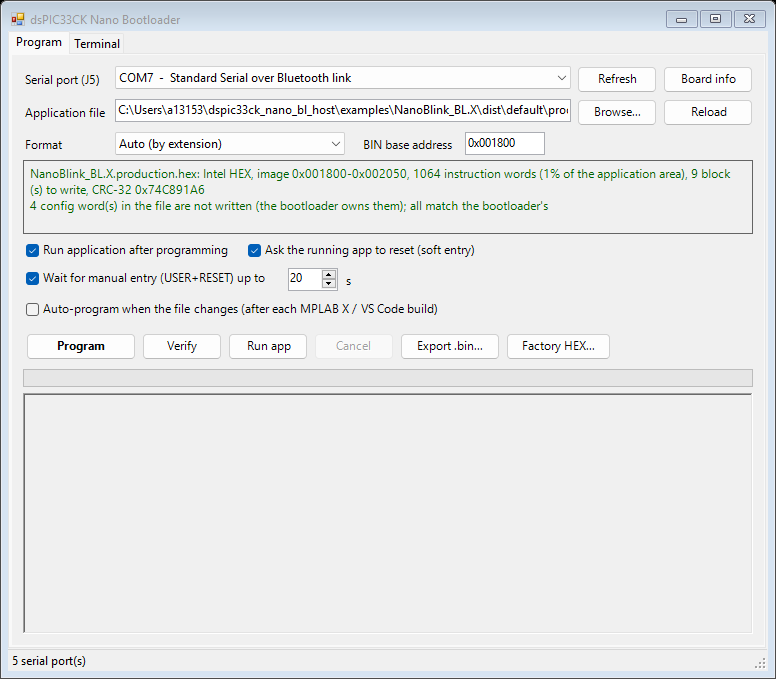

# dsPIC33CK Nano – Bootloader host for MPLAB X / VS Code

Use these tools to program applications built in **MPLAB X** or **VS Code** (XC-DSC) into the dsPIC33CK Nano board through its **serial bootloader** on header **J5**, with no PICkit needed after the first time. It speaks exactly the same protocol as the Arduino core's `serial_upload.py`. A board works with both.

| File | What it is |
|---|---|
| `bin/NanoBootloader.exe` | Windows GUI. Program / Verify / Run / Board info, auto-program after each build, UART terminal, `.bin` export, factory HEX |
| `bin/nanobl.exe` | Command line, for the MPLAB X post-build step, VS Code tasks and scripts |
| `mplabx/` | What an MPLAB X / VS Code project needs: `p33CK256MC005-app.gld`, `nano_bootloader.c/.h` (soft entry), `nano_bl_config.h` (config words), `bootloader-dspic33ck-nano-115200-v1.hex` |
| `examples/NanoBlink_BL.X` | Ready MPLAB X project (also opens in VS Code): 100 MIPS, Timer1 interrupt, UART echo, soft entry |
| `src/`, `test/`, `build.cmd` | C# source; `build.cmd` rebuilds everything with the C# compiler built into Windows |

Requirements: Windows 10/11. .NET Framework 4.x is part of Windows, so nothing has to be installed.



---

## 1. One-time setup of the board
1. **Burn the bootloader once** with a PICkit on **J4**. In MPLAB IPE, program `mplabx/bootloader-dspic33ck-nano-115200-v1.hex`. In Arduino, use *Tools > Burn Bootloader*.
2. **Connect a 3.3 V USB-serial adapter to J5:**
   - adapter TX → **J5-3** (RX, RC11)
   - adapter RX → **J5-2** (TX, RC10)
   - GND → **J5-4**
3. LED behaviour: the LED is on for 300 ms after every reset. That's the bootloader's window. It blinks at about 2 Hz while the bootloader waits for an upload, which happens when no valid application is present.

## 2. Prepare an MPLAB X project (XC-DSC, dsPIC33CK256MC005)
The application must sit **behind** the bootloader. It starts at 0x001800, and the bootloader owns the reset vector, the interrupt table and the config words.

1. **Linker script:** copy `mplabx/p33CK256MC005-app.gld` into the project and add it under **Linker Files**. It places your code at 0x001800 and builds the GOTO trampoline through which the bootloader forwards every interrupt to your normal `_T1Interrupt` / `_U1RXInterrupt` / ... handlers. You don't need to change your code.
2. **No interrupt table:** *Project Properties > xc-dsc-ld > General > "No Interrupt Vector Table"* (`--no-ivt`).
3. **Config words:** add `#include "nano_bl_config.h"` in **one** C file, or make your `#pragma config` match it. Config words are **never written over serial**; the board keeps the bootloader's values:
   - `FNOSC=FRC`
   - `FCKSM=CSECMD` (clock switching allowed)
   - `FWDTEN=ON_SW`
   - `ICS=PGD3`

   So your code must switch to the PLL at run time, which MCC's clock initialisation already does. The tools warn you, decoded, when a HEX file asks for different config values.
4. **Enable interrupts:** set `INTCON2bits.GIE = 1` (MCC: `INTERRUPT_GlobalEnable()`). On this device GIE **resets to 0**, so nothing interrupts until you set it. That's true with or without the bootloader.
5. **Soft entry** (recommended): this lets the tool update a running board without pressing buttons. Add `nano_bootloader.c/.h`, then pick one:
   - Your app uses UART1: call `NanoBL_RxByte(b)` for every received byte, in the U1RX ISR or the MCC UART1 receive callback.
   - Your app doesn't use UART1: call `NanoBL_UartInit(FCY)` once and `NanoBL_Task()` in the main loop.

   Without soft entry, use manual entry: hold **USER**, press and release **RESET**, keep USER held about 1 s. The tool waits for this if "Wait for manual entry" (`--wait`) is on.
6. Use **Build** (production), not Debug. The image is `dist/default/production/<project>.X.production.hex`.

`examples/NanoBlink_BL.X` has all of this done. Start from it, or compare against it.

## 3. Program from MPLAB X
- **GUI:** open `NanoBootloader.exe`, choose the J5 port, drop the `.hex` on the window and press **Program**. Tick *Auto-program when the file changes*: then every **Build** in MPLAB X flashes the board by itself, and the Terminal tab reopens on the app's output.
- **Post-build step (one click per build):** *Project Properties > Building > Execute this line after build*:
  ```
  "C:\NanoBootloader\nanobl.exe" --port COM7 --file ${ImagePath} --wait 20
  ```
  `${ImagePath}` expands to `"dist\default\production\<project>.X.production.hex"`. The template already contains this line, disabled. Fix the path and COM port, then tick the box.

## 4. Program from VS Code
Copy `examples/NanoBlink_BL.X/.vscode/` into your project. In `.vscode/settings.json`, set `nanoBootloader.tool`, `nanoBootloader.gui` and `nanoBootloader.port`. Then, from *Terminal > Run Task*:

| Task | Does |
|---|---|
| **Nano: build and program** (default build task, Ctrl+Shift+B) | MPLAB X makefile build, then upload |
| Nano: program via bootloader | Upload `dist/default/production/<folder>.production.hex` |
| Nano: program a file via bootloader | Asks for the file. Use this for the HEX the MPLAB extension for VS Code writes under `out/` |
| Nano: open the bootloader GUI | GUI with the project's HEX loaded |

## 5. nanobl.exe reference
```
nanobl --port COM7 --file app.hex                 program, verify, commit and run
nanobl --port COM7 --file app.X.production.elf    uses the .hex next to the ELF
nanobl --port COM7 --file app.bin [--format bin|bin4] [--base 0x1800]
nanobl --port COM7 --verify app.hex               compare board and file, write nothing (exit 3 = differs)
nanobl --port COM7 --run | --info                 start the app / show the device identity
nanobl --file app.hex --dry-run                   check a file without a board
nanobl --file app.hex --export-bin app.bin        packed image: 3 bytes per word, first word at 0x001800
nanobl --file app.hex --combine bootloader.hex --out factory.hex
nanobl --list
options: --no-run  --no-soft-entry  --soft-baud 115200,9600  --wait SEC  --quiet  --verbose
```

**File formats**
- **.hex:** XC-DSC Intel HEX, 4 bytes per instruction word, address ×2.
- **.elf:** the `.hex` next to it is used.
- **.bin**, auto-detected, or forced with `--format` / the GUI combo:
  - `bin`: 3 bytes per word, little-endian. This is exactly the flash content, and what `--export-bin` writes.
  - `bin4`: 4 bytes per word with a zero "phantom" byte.

  Both start at `--base` (default 0x001800). Words of 0xFFFFFF are treated as erased.

**Factory HEX:** bootloader + application + signature row in one file. Program it with a PICkit or MPLAB IPE for production. The board then boots straight into the application and can still be updated over serial later.

## 6. How an upload works, and what is checked
1. **Find the bootloader:**
   - SYNC: is the bootloader already listening?
   - If not, send the soft-entry sequence to the running app at several baud rates, then flood SYNC into the 300 ms window.
   - If that fails too, wait for manual entry.

   The board's protocol version and memory map are compared with the tool's. A mismatch stops the upload.
2. **ERASE** the application area. From now until COMMIT the board has no valid application, so an interrupted upload leaves it safely waiting in the bootloader.
3. **WRITE_ROW** blocks of 128 words. Blocks that are entirely blank are skipped.
4. **READ_CRC:** the board's own CRC-32 of the whole area must equal the file's.
5. **COMMIT** writes the signature row. The board checks the CRC again before writing it.
6. **JUMP** starts the app.

**ECC-safe retries.** dsPIC33CK flash has ECC, and a double-word must not be programmed twice between erases. So when the reply to WRITE_ROW or COMMIT is lost, the tool does **not** blindly re-send it. It first asks the board for the CRC of that block:
- already written → carry on
- still erased → send it again
- anything else → restart from ERASE

The image checks refuse:
- code below 0x001800 (linked with the stock script)
- code reaching the signature row at 0x02B700
- a bad HEX checksum or phantom byte
- duplicate addresses

They also warn when the entry at 0x001800 is not a GOTO, and when config words differ from the bootloader's.

## 7. Verification status
- **Host vs. the Arduino reference:** a bootloader-linked Arduino HEX (Lab11) gives the same image span, block count and CRC-32 (0x0858936E) as `serial_upload.py --dry-run`.
- **`test/` against an emulator of `bl_main.c`, 22/22 pass:**
  - soft entry at 9600 baud
  - re-upload over a valid application
  - lost or corrupted answers and a lost request, with **no flash word programmed twice**
  - lost COMMIT answer
  - verify match and mismatch
  - no soft-entry path
  - `--no-run`
  - BIN 3/4-byte round trips
  - factory HEX
  - config-word warnings
  - stock-linked and oversized images
  - HEX checksum errors
  - ELF → HEX
- **Template project:**
  - Builds in the MPLAB X makefile flow with `--no-ivt` + app `.gld`, with no warnings, and its config words equal the bootloader's.
  - The post-build step with `${ImagePath}` ran `nanobl.exe` successfully.
  - **MPLAB simulator** run of the factory HEX (the real bootloader firmware plus this app): the bootloader accepted the signature and jumped, the app switched to the PLL, and the Timer1 interrupt counted via bootloader IVT → trampoline → `_T1Interrupt`.
  - UART1 RX is routed the same way (checked statically: IVT 0x002A → 0x001850 → `_U1RXInterrupt`).
- **Not yet tested on a real board and adapter:** the serial timing, soft entry with a USB-serial adapter's latency, and the GUI terminal. The executables are unsigned, so Windows SmartScreen may ask for confirmation the first time.
